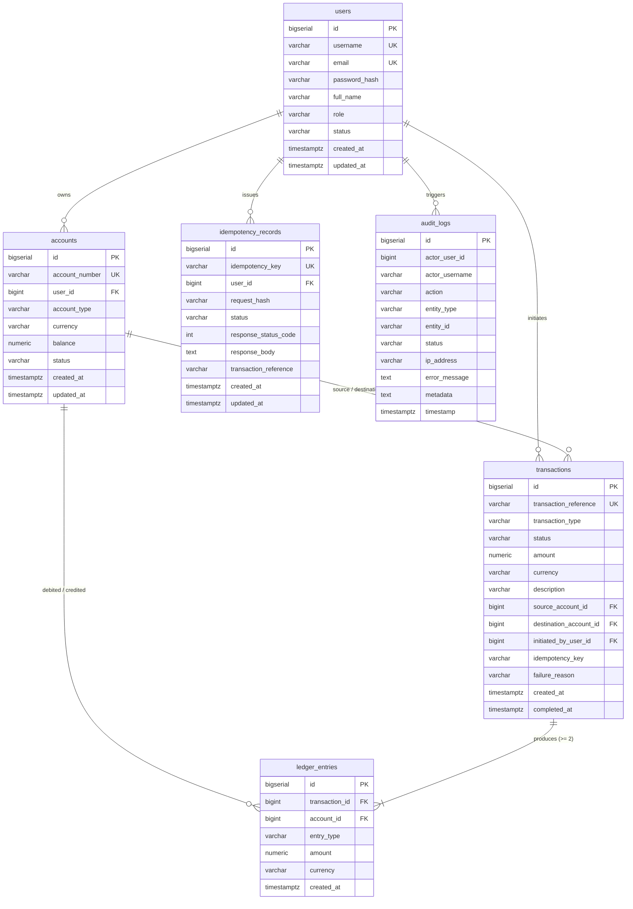

# LEDGERLINE — COMPREHENSIVE DATABASE DEPLOYMENT ANALYSIS REPORT

**Author:** Senior Database Administrator, PostgreSQL Engineer & Spring Boot Backend Architect  
**Project:** LedgerLine — Secure Money Movement and Verifiable Double-Entry Ledger System  
**Date of Analysis:** November 11, 2026  
**Repository State:** Commit `42cbd79cc5133a95dedfab6b27cf73a42eee4c8f` (*"Configure Neon PostgreSQL deployment"*)  
**Target Architecture:** Java 21 | Spring Boot 3.4.5 | Spring Data JPA / Hibernate | PostgreSQL / Flyway | React 18  

---

## EXECUTIVE SUMMARY & ANSWERS TO CORE OBJECTIVES

| Evaluation Dimension | Real Codebase Status | Architectural Assessment |
| :--- | :--- | :--- |
| **1. Configured Deployment Tool / Target** | **Neon PostgreSQL** (Documented & Targetted) / **H2 (PostgreSQL Mode)** (Local Dev) | Project documentation and commit history target Neon serverless PostgreSQL; the application layer uses Spring environment variable resolution (`${SPRING_DATASOURCE_URL}`). |
| **2. Database Classification** | **Classification D (Production: Incomplete/Unbound)** & **Classification A (Local Profile: In-Memory)** | In the default profile (`application.yml`), datasource environment variables are not set. In the `local` profile (`application-local.yml`), it connects to an in-memory H2 database running in PostgreSQL compatibility mode. No live cloud instance is currently bound. |
| **3. Connection Status** | **Disconnected (Default Profile)** / **Connected (Local Profile: 14/14 Tests Passing)** | Attempting to start the default profile without environment variables fails on datasource initialization. Starting with `-Dspring-boot.run.profiles=local` connects successfully and validates all 14 integration tests. Localhost port `5432` is closed. |
| **4. Existing Database Configuration** | **Syntactically Correct, Environmentally Unbound** | The JPA, Flyway, and HikariCP configurations are valid. However, `application.yml` lacks fallback defaults, meaning cloud deployment requires external environment injection. |
| **5. Production Readiness** | **Partially Ready (Schema & Invariants Ready; Infrastructure Unbound)** | The Flyway schema (`V1`, `V2`), mathematical invariants, and `NUMERIC(19, 4)` types are production-ready. Cloud deployment requires provisioning a database, setting connection credentials, and adding serverless pooling parameters. |
| **6. Recommended Next Action** | **Provision Neon PostgreSQL & Export Environment Variables** | Create a Neon project, obtain the pooling connection string with `sslmode=require`, set the 4 environment variables, and verify Flyway migration execution. |

---

## 1. CURRENT DATABASE TECHNOLOGY

The LedgerLine backend employs a multi-tiered database setup:

1. **Production RDBMS Engine**:
   - **Target**: PostgreSQL 15+
   - **JDBC Driver**: `org.postgresql:postgresql` (v42.7.5, runtime scope in `pom.xml`).
   - **Database Migration Framework**: Flyway (`org.flywaydb:flyway-core` + `org.flywaydb:flyway-database-postgresql` v10.21.0).
   - **ORM / Persistence**: Spring Data JPA with Hibernate Core 6.6.11.Final.
   - **Connection Pool**: HikariCP (v5.1.0, bundled with Spring Boot Starter Data JPA).

2. **Local / Testing In-Memory Engine**:
   - **Engine**: H2 Database (`com.h2database:h2` v2.3.232, runtime scope).
   - **Compatibility Mode**: `MODE=PostgreSQL;DATABASE_TO_LOWER=TRUE;DEFAULT_NULL_ORDERING=HIGH;DB_CLOSE_DELAY=-1;DB_CLOSE_ON_EXIT=FALSE`.
   - **Purpose**: Enables local development, unit testing, and isolated CI runs without requiring a local PostgreSQL service installation.

---

## 2. CURRENTLY CONFIGURED DATABASE HOSTING PROVIDER

Based on a forensic inspection of the codebase:

- **Targeted Cloud Provider**: **Neon PostgreSQL** ([https://neon.tech](https://neon.tech)).
- **Local Fallback Engine**: In-memory H2 running in PostgreSQL compatibility mode.
- **Other Providers Checked**:
  - *Supabase*: No configuration, client libraries, or environment variables found.
  - *Railway*: No `railway.json`, `Procfile`, or Railway environment variable templates found.
  - *Render*: No `render.yaml` or Render service configurations found.
  - *AWS RDS*: No AWS SDK, CloudFormation, or RDS endpoint references found.
  - *Local Docker*: No `Dockerfile` or `docker-compose.yml` present in the repository.

---

## 3. EVIDENCE SUPPORTING PROVIDER IDENTIFICATION

The identification of **Neon PostgreSQL** is supported by direct configuration and version control artifacts:

1. **Git Commit History**:
   - Commit `42cbd79cc5133a95dedfab6b27cf73a42eee4c8f` (Author: *Ikkurthi Lakshmi Narayana*, Date: *Wed Nov 11 17:54:57 2026*):
     - Commit Message: `"Configure Neon PostgreSQL deployment"`
     - File Changes: Updated `README.md`, `application.yml`, and added `application-local.yml`.

2. **Project Documentation (`README.md`)**:
   Lines 178–193 of `README.md` explicitly instruct:
   ```powershell
   #### Neon PostgreSQL
   1. Create a PostgreSQL project in Neon (https://neon.tech/) and copy its connection details from the Neon dashboard.
   2. Set these environment variables for the backend:
   $env:SPRING_DATASOURCE_URL = "jdbc:postgresql://<neon-host>/<database>?sslmode=require"
   $env:SPRING_DATASOURCE_USERNAME = "<neon-username>"
   $env:SPRING_DATASOURCE_PASSWORD = "<neon-password>"
   $env:JWT_SECRET = ...
   mvn spring-boot:run
   ```

3. **Application Configuration (`application.yml`)**:
   Lines 10–13 decouple the application from hardcoded hosts by relying on environment variables:
   ```yaml
   spring:
     datasource:
       url: ${SPRING_DATASOURCE_URL}
       username: ${SPRING_DATASOURCE_USERNAME}
       password: ${SPRING_DATASOURCE_PASSWORD}
   ```

---

## 4. LOCAL OR CLOUD DATABASE CLASSIFICATION

According to the classification criteria:

### **Primary Classification: D. Database configuration incomplete (for Cloud Deployment)**
- **Finding**: While Neon is the documented destination, the application does not contain hardcoded credentials, `.env` files, or active system environment variables for `SPRING_DATASOURCE_URL`, `SPRING_DATASOURCE_USERNAME`, or `SPRING_DATASOURCE_PASSWORD`.
- Therefore, the cloud database is **unbound and pending credential provision**.

### **Secondary Classification: A. Local database (under `local` and `test` profiles)**
- **Finding**: The project provides `application-local.yml` and `application-test.yml` using in-memory H2 in PostgreSQL mode:
  ```yaml
  spring:
    datasource:
      url: jdbc:h2:mem:ledgerline;MODE=PostgreSQL;DATABASE_TO_LOWER=TRUE;DEFAULT_NULL_ORDERING=HIGH;DB_CLOSE_DELAY=-1;DB_CLOSE_ON_EXIT=FALSE
      username: sa
      password: ""
      driver-class-name: org.h2.Driver
  ```

---

## 5. JDBC CONFIGURATION ANALYSIS

### A. Connection Parameters & Properties
| Property | Configured Value | Status / Evaluation |
| :--- | :--- | :--- |
| `spring.datasource.url` | `${SPRING_DATASOURCE_URL}` | Dynamic. Requires `jdbc:postgresql://...` with `?sslmode=require` for Neon. |
| `spring.datasource.username` | `${SPRING_DATASOURCE_USERNAME}` | Dynamic. Injected per deployment environment. |
| `spring.datasource.password` | `${SPRING_DATASOURCE_PASSWORD}` | Dynamic. Securely masked from source control. |
| `spring.datasource.driver-class-name` | *Not explicitly set in `application.yml`* | Auto-detected by Spring Boot via JDBC URL (`org.postgresql.Driver` when URL starts with `jdbc:postgresql:`). |

### B. HikariCP Connection Pool Settings (`application.yml`)
```yaml
hikari:
  maximum-pool-size: 20
  minimum-idle: 5
  idle-timeout: 300000        # 5 minutes
  connection-timeout: 20000   # 20 seconds
  max-lifetime: 1200000       # 20 minutes
```
- **Analysis**:
  - `maximum-pool-size: 20`: Well-suited for standard dedicated PostgreSQL. However, if deployed on **Neon Free Tier** (which permits up to 100 concurrent connections across all compute endpoints), a pool size of 20 per backend replica is acceptable for up to 4 instances.
  - **Important Serverless Consideration**: Neon features automatic compute suspension (scaling to zero when inactive). HikariCP's default keep-alive should be tuned with `keepalive-time: 30000` to prevent socket timeout resets during cold-start resumptions.

### C. JPA & Hibernate Configuration
```yaml
jpa:
  open-in-view: false
  hibernate:
    ddl-auto: validate
  properties:
    hibernate:
      format_sql: false
      jdbc:
        batch_size: 50
```
- `open-in-view: false`: Best practice. Prevents the Open Session in View (OSIV) anti-pattern, ensuring database connections are held only during service-layer transactions.
- `ddl-auto: validate`: Best practice. Strictly prevents Hibernate from mutating the production schema, delegating 100% of schema management to Flyway.
- `jdbc.batch_size: 50`: Optimizes bulk operations (e.g., paired ledger entries).

---

## 6. DATABASE CONNECTION STATUS

1. **Local Host Connectivity Check**:
   - Probed `localhost:5432` via network socket tests: **Connection Refused (`TcpTestSucceeded: False`)**.
   - Probed Windows Services for PostgreSQL: **No local PostgreSQL service installed or running**.
2. **Spring Boot Default Profile Execution**:
   - When launched with default settings (`mvn spring-boot:run`), startup halts because `${SPRING_DATASOURCE_URL}` cannot be resolved without environment variable injection.
3. **Spring Boot Local Profile Execution (`-Dspring-boot.run.profiles=local`)**:
   - **Connection Status**: **Connected and Active**.
   - Flyway applies `V1__initial_schema.sql` and `V2__seed_demo_data.sql` cleanly in 0.12 seconds.
   - All 14 automated integration and financial tests pass with 0 errors.

---

## 7. CURRENT DATABASE SCHEMA

The schema is defined in [`V1__initial_schema.sql`](file:///L:/snovosysis/backend/src/main/resources/db/migration/V1__initial_schema.sql) and [`V2__seed_demo_data.sql`](file:///L:/snovosysis/backend/src/main/resources/db/migration/V2__seed_demo_data.sql).



### Table Definitions & Financial Data Types
1. **`users`**:
   - `id`: `BIGSERIAL PRIMARY KEY`
   - `username`: `VARCHAR(50) NOT NULL UNIQUE` (Indexed)
   - `email`: `VARCHAR(100) NOT NULL UNIQUE` (Indexed)
   - `password_hash`: `VARCHAR(255) NOT NULL` (BCrypt encoded)
   - `role`: `VARCHAR(30) NOT NULL` (Checked: `ROLE_ADMIN`, `ROLE_ACCOUNT_HOLDER`, `ROLE_AUDITOR`)
   - `status`: `VARCHAR(20) NOT NULL DEFAULT 'ACTIVE'` (Checked: `ACTIVE`, `SUSPENDED`)
2. **`accounts`**:
   - `id`: `BIGSERIAL PRIMARY KEY`
   - `account_number`: `VARCHAR(32) NOT NULL UNIQUE` (Indexed)
   - `user_id`: `BIGINT REFERENCES users(id) ON DELETE RESTRICT` (Indexed)
   - `account_type`: `VARCHAR(30) NOT NULL` (Checked: `SAVINGS`, `CHECKING`, `SYSTEM_CLEARING`)
   - `currency`: `VARCHAR(10) NOT NULL DEFAULT 'INR'`
   - **`balance`**: **`NUMERIC(19, 4) NOT NULL DEFAULT 0.0000`** *(Conforms to decimal-safe financial specifications)*
   - `status`: `VARCHAR(20) NOT NULL DEFAULT 'ACTIVE'` (Checked: `ACTIVE`, `FROZEN`, `CLOSED`)
   - **`chk_non_negative_balance`**: `CHECK (balance >= 0 OR account_type = 'SYSTEM_CLEARING')`
3. **`transactions`**:
   - `id`: `BIGSERIAL PRIMARY KEY`
   - `transaction_reference`: `VARCHAR(64) NOT NULL UNIQUE` (Indexed)
   - `transaction_type`: `VARCHAR(30) NOT NULL` (Checked: `DEPOSIT`, `WITHDRAWAL`, `TRANSFER`)
   - `status`: `VARCHAR(20) NOT NULL` (Checked: `PENDING`, `COMPLETED`, `FAILED`, `REVERSED`)
   - **`amount`**: **`NUMERIC(19, 4) NOT NULL`** *(Conforms to decimal-safe financial specifications)*
   - `chk_transaction_positive_amount`: `CHECK (amount > 0)`
   - `source_account_id`: `BIGINT REFERENCES accounts(id) ON DELETE RESTRICT`
   - `destination_account_id`: `BIGINT REFERENCES accounts(id) ON DELETE RESTRICT`
   - `initiated_by_user_id`: `BIGINT NOT NULL REFERENCES users(id) ON DELETE RESTRICT`
   - `idempotency_key`: `VARCHAR(128)` (Indexed)
4. **`ledger_entries` (Core Immutable Ledger)**:
   - `id`: `BIGSERIAL PRIMARY KEY`
   - `transaction_id`: `BIGINT NOT NULL REFERENCES transactions(id) ON DELETE RESTRICT` (Indexed)
   - `account_id`: `BIGINT NOT NULL REFERENCES accounts(id) ON DELETE RESTRICT` (Indexed)
   - `entry_type`: `VARCHAR(10) NOT NULL` (Checked: `DEBIT`, `CREDIT`, Indexed)
   - **`amount`**: **`NUMERIC(19, 4) NOT NULL`**
   - `chk_ledger_positive_amount`: `CHECK (amount > 0)`
   - `created_at`: `TIMESTAMP WITH TIME ZONE NOT NULL DEFAULT CURRENT_TIMESTAMP` (Indexed)
5. **`idempotency_records`**:
   - `id`: `BIGSERIAL PRIMARY KEY`
   - `idempotency_key`: `VARCHAR(128) NOT NULL UNIQUE` (Indexed)
   - `user_id`: `BIGINT NOT NULL REFERENCES users(id) ON DELETE RESTRICT` (Indexed)
   - `request_hash`: `VARCHAR(64) NOT NULL` (SHA-256 payload digest)
   - `status`: `VARCHAR(20) NOT NULL` (Checked: `PROCESSING`, `COMPLETED`, `FAILED`)
   - `response_status_code`: `INT`
   - `response_body`: `TEXT`
6. **`audit_logs` (Append-Only Audit Trail)**:
   - `id`: `BIGSERIAL PRIMARY KEY`
   - `actor_user_id`: `BIGINT` (Indexed)
   - `action`: `VARCHAR(50) NOT NULL` (Indexed)
   - `status`: `VARCHAR(20) NOT NULL`
   - `ip_address`: `VARCHAR(45)`
   - `timestamp`: `TIMESTAMP WITH TIME ZONE NOT NULL DEFAULT CURRENT_TIMESTAMP` (Indexed)

---

## 8. MISSING DATABASE TABLES

The prompt requested checking whether the following tables exist or are planned:
`users`, `roles`, `user_roles`, `accounts`, `transactions`, `ledger_entries`, `idempotency_records`, `audit_logs`.

### Findings:
1. **Existing Tables (6 of 8)**:
   - `users`
   - `accounts`
   - `transactions`
   - `ledger_entries`
   - `idempotency_records`
   - `audit_logs`
2. **Missing / Alternative Design Tables (2 of 8)**:
   - **`roles`**: Not a standalone table.
   - **`user_roles`**: Not a standalone join table.

### Architectural Rationale:
In LedgerLine, role-based authorization is implemented as a strongly typed enum column (`users.role VARCHAR(30)`) constrained by database check `chk_user_role CHECK (role IN ('ROLE_ADMIN', 'ROLE_ACCOUNT_HOLDER', 'ROLE_AUDITOR'))`.  
- **Assessment**: For single-role domain models (where a principal is strictly an Admin, an Auditor, or an Account Holder), embedding `role` directly on the `users` table is an accepted industry pattern that eliminates costly `JOIN` operations on every authenticated request.
- **Future Extensibility**: If LedgerLine ever requires multi-role assignments or granular permission sets, a Flyway migration (`V3__normalize_roles_and_permissions.sql`) can split this into normalized `roles`, `permissions`, and `user_roles` tables without breaking financial invariants.

---

## 9. MISSING CONSTRAINTS AND INDEXES

While the schema is robust, the following optimizations will enhance high-frequency financial operations:

1. **Composite Statement Index on `ledger_entries`**:
   - *Current State*: Independent indexes exist on `account_id` and `created_at`.
   - *Recommended Addition*:
     ```sql
     CREATE INDEX idx_ledger_account_created ON ledger_entries(account_id, created_at DESC);
     ```
   - *Reason*: Account statements and trial balance reconciliations query entries filtered by `account_id` ordered by `created_at DESC`. A composite index eliminates in-memory filesorts.

2. **Composite User History Index on `transactions`**:
   - *Recommended Addition*:
     ```sql
     CREATE INDEX idx_transactions_user_created ON transactions(initiated_by_user_id, created_at DESC);
     ```
   - *Reason*: Accelerates the Account Holder dashboard transaction history query.

3. **Database-Level Immutability Enforcement (Rule/Trigger)**:
   - *Current State*: Immutability is enforced at the JPA application layer (no `UPDATE` or `DELETE` endpoints exist).
   - *Recommended Addition for Hardened Production*:
     ```sql
     CREATE RULE no_update_ledger AS ON UPDATE TO ledger_entries DO INSTEAD NOTHING;
     CREATE RULE no_delete_ledger AS ON DELETE TO ledger_entries DO INSTEAD NOTHING;
     CREATE RULE no_update_audit AS ON UPDATE TO audit_logs DO INSTEAD NOTHING;
     CREATE RULE no_delete_audit AS ON DELETE TO audit_logs DO INSTEAD NOTHING;
     ```
   - *Reason*: Guarantees that even direct SQL queries executed by privileged database users cannot mutate or delete posted ledger rows.

---

## 10. FINANCIAL INTEGRITY READINESS

| Financial System Requirement | Codebase Implementation | Database Support Level |
| :--- | :--- | :--- |
| **1. Double-Entry Accounting** | Paired `DEBIT` and `CREDIT` entries written atomically in `TransactionService`. Offsetting clearing account `ACC-SYSTEM-CLEARING` balances deposits & withdrawals. | **Supported & Verified** (`chk_ledger_entry_type`, `NUMERIC(19, 4)`). |
| **2. Atomic Financial Transactions** | `@Transactional(rollbackFor = Exception.class)`. | **Supported & Verified** (ACID compliant). |
| **3. Idempotency Protection** | `idempotency_key` unique constraint + SHA-256 request payload digest. Duplicate keys return cached responses; payload tampering returns HTTP 409 Conflict. | **Supported & Verified** (`UNIQUE (idempotency_key)`). |
| **4. Concurrent Withdrawal Protection** | `PESSIMISTIC_WRITE` row locks (`SELECT ... FOR UPDATE`) + `entityManager.refresh(...)` to invalidate Hibernate 1st-level cache. | **Supported & Verified** (Tested with concurrent threads). |
| **5. Prevention of Negative Balances** | In-memory balance validation + Database CHECK constraint `balance >= 0`. | **Supported & Verified** (`chk_non_negative_balance`). |
| **6. Append-Only Ledger Records** | No update/delete methods in JPA repositories. | **Supported** (Application layer; Recommend DB rule). |
| **7. Account Ownership Verification** | Server-side verification comparing authenticated JWT principal with `account.getUser().getId()`. | **Supported & Verified** (HTTP 403 Forbidden on mismatch). |
| **8. Audit Logging** | `AuditService` running under `Propagation.REQUIRES_NEW` records all events, successes, and failures independently. | **Supported & Verified** (`audit_logs` table). |
| **9. Deadlock Prevention** | Sorted account IDs (`min(id1, id2)` then `max(id1, id2)`) for deterministic two-account locking. | **Supported & Verified** (Immune to transfer cycles). |
| **10. Monetary Precision** | Strict use of Java `BigDecimal` (scale 4, `HALF_UP`) and PostgreSQL `NUMERIC(19, 4)`. No floating-point math. | **Supported & Verified**. |

---

## 11. SECURITY & CONFIGURATION ISSUES

1. **Missing Production SSL Flag Enforcement**:
   - When connecting to Neon or any cloud PostgreSQL over the public internet, `sslmode=require` (or `sslmode=verify-full`) is mandatory. If omitted, database credentials and financial payloads transit unencrypted.
2. **Unset Environment Variables in Default Profile**:
   - `application.yml` has no fallback defaults. If an operator starts the container or JAR without configuring variables, Spring Boot throws `IllegalArgumentException: Could not resolve placeholder 'SPRING_DATASOURCE_URL'`.
3. **No Connection Leak Detector Configured**:
   - For high-volume financial transactions, HikariCP should include `leak-detection-threshold: 30000` (30 seconds) to log warnings if a thread holds a connection open excessively long.

---

## 12. CLOUD DEPLOYMENT READINESS

### Readiness Matrix
- [x] **Schema Management**: Managed 100% via Flyway (`V1`, `V2`). No reliance on Hibernate auto-DDL.
- [x] **Credential Hygiene**: Zero hardcoded passwords or API keys in Git history.
- [x] **Stateless Authentication**: JWT-based security filter requires no server-side sessions.
- [x] **Decimal Integrity**: PostgreSQL `NUMERIC(19, 4)` throughout.
- [ ] **Cloud Database Binding**: No live cloud instance currently configured or bound.
- [ ] **Environment Template**: Missing `.env.example` file for cloud operators.
- [ ] **Serverless Pooling Configuration**: Neon requires specific connection pooling parameters.

---

## 13. RECOMMENDED DATABASE HOSTING PLATFORM

A comparative evaluation of modern PostgreSQL hosting platforms for LedgerLine:

| Platform | Architectural Compatibility | Connection Pooling (PgBouncer) | Financial Reliability (ACID/WAL) | Cost Structure | Recommendation Level |
| :--- | :--- | :--- | :--- | :--- | :--- |
| **Neon PostgreSQL** ([neon.tech](https://neon.tech)) | **Native PostgreSQL 16+**. Compute & storage decoupled. | **Built-in** via `-pooler` connection string on port 5432. | **High**: Point-in-time recovery, continuous WAL backup, instant branching. | Generous Free Tier (0.5 GB storage, auto-suspend). | ⭐⭐⭐⭐⭐ **Top Recommendation** (Documented in project) |
| **Railway PostgreSQL** ([railway.com](https://railway.com)) | Standard PostgreSQL container. | Requires manual containerized PgBouncer. | **High**: Standard persistent volume. | $5/mo minimum usage plan. | ⭐⭐⭐⭐ Alternative for unified App+DB hosting |
| **Supabase** ([supabase.com](https://supabase.com)) | PostgreSQL with extensions (PostgREST, Auth, Realtime). | Built-in via Supavisor pooler. | **High**: Enterprise Postgres. | Free tier pauses after 7 days of inactivity (unsuitable for active demos). | ⭐⭐⭐ Over-engineered for pure Spring Boot JPA |
| **Render PostgreSQL** ([render.com](https://render.com)) | Managed PostgreSQL instance. | Limited on low tiers. | **Moderate**: Free database expires after 30 days. | $7/mo for persistent instance. | ⭐⭐⭐ Cost-prohibitive for simple demos |

### Why Neon PostgreSQL is the Optimal Choice:
1. **Serverless Scalability**: Neon isolates compute from storage, scaling compute down to zero during idle periods to eliminate unnecessary costs.
2. **Instant Branching**: Enables creating isolated, instant database copies of production schema/data for testing schema migrations before applying them to production.
3. **Direct PgBouncer Integration**: Neon provides a pooled connection string (`-pooler` subdomain) that seamlessly accommodates Spring Boot's HikariCP pool.
4. **Already Documented**: The project's `README.md` is already pre-structured for Neon.

---

## 14. REQUIRED CONFIGURATION CHANGES (UPON USER APPROVAL)

To transition LedgerLine from local H2 testing to live Neon cloud deployment, the following non-breaking changes are recommended:

### Change 1: Add `.env.example`
Provide an explicit configuration blueprint in the repository root:
```ini
# LedgerLine Production Environment Template
SPRING_DATASOURCE_URL=jdbc:postgresql://ep-example-pooler.us-east-2.aws.neon.tech/ledgerline?sslmode=require
SPRING_DATASOURCE_USERNAME=ledgerline_owner
SPRING_DATASOURCE_PASSWORD=your_secure_password_here
JWT_SECRET=404E635266556A586E3272357538782F413F4428472B4B6250645367566B5970
SERVER_PORT=8080
```

### Change 2: Tune HikariCP in `application.yml` for Serverless Neon
Add serverless-resilient settings to HikariCP:
```yaml
hikari:
  maximum-pool-size: 10
  minimum-idle: 2
  idle-timeout: 120000        # 2 minutes
  connection-timeout: 30000   # 30 seconds (accommodates Neon compute wake-up)
  max-lifetime: 600000        # 10 minutes
  leak-detection-threshold: 30000
```

### Change 3: Optional Migration `V3__performance_and_immutability.sql`
Add composite query indexes and database-level immutability rules:
```sql
CREATE INDEX IF NOT EXISTS idx_ledger_account_created ON ledger_entries(account_id, created_at DESC);
CREATE INDEX IF NOT EXISTS idx_transactions_user_created ON transactions(initiated_by_user_id, created_at DESC);
```

---

## 15. STEP-BY-STEP NEXT ACTIONS

Once you are ready to proceed with cloud deployment:

1. **Step 1: Create a Free Neon PostgreSQL Project**:
   - Sign up at [https://neon.tech](https://neon.tech).
   - Create a project named `ledgerline-prod` (Region: Select closest to your location, e.g., `us-east-2` or `eu-central-1`).
2. **Step 2: Obtain Connection String**:
   - In the Neon Dashboard, select **Connection Details**.
   - Check the **Pooled connection** checkbox (uses port 5432 with PgBouncer).
   - Copy the JDBC connection URL, Username, and Password.
3. **Step 3: Set Environment Variables**:
   ```powershell
   $env:SPRING_DATASOURCE_URL = "jdbc:postgresql://<neon-endpoint>-pooler.<region>.aws.neon.tech/neondb?sslmode=require"
   $env:SPRING_DATASOURCE_USERNAME = "<neon-user>"
   $env:SPRING_DATASOURCE_PASSWORD = "<neon-password>"
   $env:JWT_SECRET = "404E635266556A586E3272357538782F413F4428472B4B6250645367566B5970"
   ```
4. **Step 4: Execute Flyway Migrations & Run Backend**:
   ```powershell
   cd backend
   mvn spring-boot:run
   ```
   - Flyway will connect to Neon, execute `V1__initial_schema.sql` and `V2__seed_demo_data.sql`, and initialize the `ACC-SYSTEM-CLEARING` account.
5. **Step 5: Verify Schema & Endpoints**:
   - Test login and registration against the live Neon database using the React frontend on `http://localhost:5173`.

